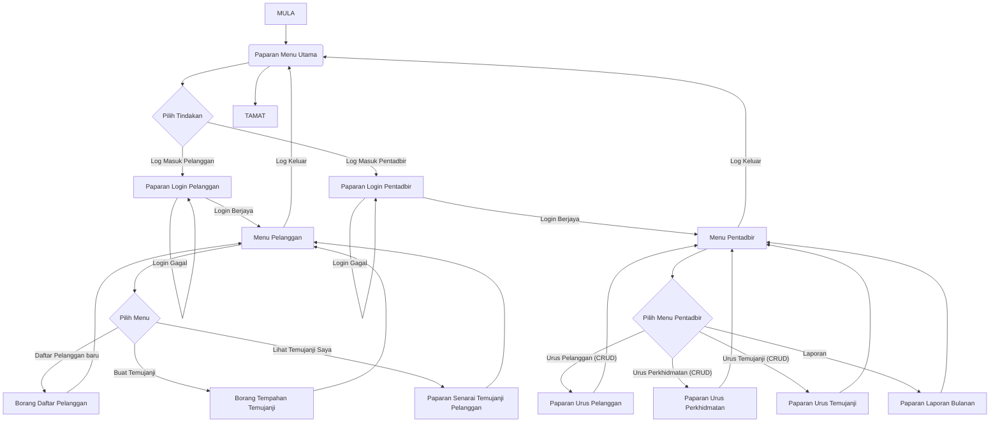

This is an excellent topic choice. The name "Sistem Temujanji Hair Salon" is functional, but to make it more marketable and professional, you could rename it something like: **"Sistem e-Gunting: Pengurusan Temujanji Salon Rambut"**.

Here is a designed example for the first two phases of your coursework, fully compliant with the SPM 2027 requirements, including the **handwriting-only rule** and the **individual student** scope.

---

**[Start of Coursework Submission - Phase 1 Hand-Written Report]**

### **KERJA KURSUS SAINS KOMPUTER (3770/2)**

**TAHUN 2026 / 2027**

**NAMA CALON:** [NAMA ANDA]
**NO. KAD PENGENALAN:** [NO. IC ANDA]
**ANGKA GILIRAN:** [AKAN DIBERIKAN OLEH SEKOLAH]
**TINGKATAN:** 4 [TAHUN 2026]

---

## **FASA 1: MENGANALISIS MASALAH (12 MARKAH)**

### **1.0 Pengenalan Tema**

Tugasan projek ini bertemakan sistem janji temu. Fokus utama ialah membangunkan satu aplikasi berasaskan web untuk menguruskan tempahan perkhidmatan secara digital bagi menggantikan kaedah konvensional.

### **1.1 Penyataan Masalah**

Salon Rambut [Nama Salon Anda, cth: Salon Cantik Ria] masih menggunakan kaedah manual dalam menguruskan temujanji pelanggan. Kaedah ini mempunyai beberapa kelemahan yang menjejaskan kecekapan operasi dan kepuasan pelanggan:

1. **Kesilapan Penjadualan:** Temujanji sering bertindih kerana direkod menggunakan buku catatan fizikal, menyebabkan masa menunggu yang lama bagi pelanggan.
2. **Proses Sukar:** Pelanggan terpaksa membuat panggilan telefon berulang kali untuk menyemak kekosongan slot masa jurugaya rambut.
3. **Rekod Tidak Teratur:** Data pelanggan dan sejarah perkhidmatan tidak disimpan secara sistematik, menyukarkan pihak salon untuk menghantar peringatan temujanji atau promosi.

### **1.2 Objektif Sistem**

Objektif utama sistem ini adalah untuk membangunkan aplikasi web yang dapat:

1. **Merekod Temujanji:** Membolehkan pelanggan mendaftar dan menempah slot temujanji secara dalam talian dengan jurugaya pilihan mereka.
2. **Memaparkan Jadual:** Membolehkan pihak pentadbir salon melihat senarai temujanji harian secara sistematik dan mengelakkan pertindihan jadual.

### **1.3 Skop Sistem**

Sistem ini hanya boleh digunakan oleh dua kumpulan pengguna utama:

1. **Pelanggan:** Boleh mendaftar, log masuk, memilih perkhidmatan, memilih jurugaya, memilih tarikh/masa, dan mengesahkan temujanji. Pelanggan juga boleh melihat senarai temujanji mereka sendiri.
2. **Pentadbir Salon:** Boleh mendaftar masuk, melihat, menambah, mengemas kini, dan memadam maklumat pelanggan, perkhidmatan, dan temujanji (fungsi CRUD penuh).
**Batasan:** Sistem ini hanya boleh dicapai menggunakan pelayar web dalam rangkaian setempat (LAN) atau pelayan pelayan web tempatan (localhost) semasa fasa pembangunan. Ia tidak memerlukan pembayaran dalam talian secara langsung.

### **1.4 Kumpulan Sasaran**

Sistem ini disasarkan kepada dua kumpulan:

1. Pelanggan yang ingin mendapatkan perkhidmatan di Salon Cantik Ria.
2. Pentadbir (Pemilik atau Pekerja Salon) yang menguruskan operasi harian salon.

### **1.5 Penilaian Sistem Sedia Ada**

Kaedah manual yang digunakan sekarang menyebabkan kesilapan dan ketidakcekapan. Keperluan untuk sistem baharu adalah kritikal bagi:

* Meningkatkan kecekapan pengurusan masa salon.
* Memodenkan imej perniagaan.
* Meningkatkan kepuasan pelanggan melalui kemudahan perkhidmatan dalam talian.
Sistem baharu ini akan dinamakan sebagai **e-Gunting Salon**.

### **1.6 Tempoh Pelaksanaan Projek**

Projek ini akan dilaksanakan mengikut fasa yang ditetapkan oleh Lembaga Peperiksaan, bermula dari Ogos 2026 hingga Jun 2027.

**Jadual Pelaksanaan Projek (Ringkas):**

| Fasa | Aktiviti Utama | Tempoh |
| --- | --- | --- |
| **Fasa 1** | Menganalisis Masalah (Dokumen Folio) | Ogos 2026 |
| **Fasa 2** | Mereka Bentuk Penyelesaian (Folio) | September - Oktober 2026 |
| **Fasa 3 & 4** | Pembangunan & Pengujian Sistem (Coding & Testing) | Januari - Mei 2027 |
| **Fasa 5** | Dokumentasi & Serahan (Serahan Softcopy & Folio) | Jun 2027 |

---

**[End of Hand-Written Report for Phase 1]**

---

**[Start of Coursework Submission - Phase 2 Hand-Written Report]**

## **FASA 2: MEREKA BENTUK PENYELESAIAN (28 MARKAH)**

### **2.1 Algoritma (Carta Alir)**

[**LUKIS CARTA ALIR INI DENGAN TULISAN TANGAN, MENGGUNAKAN SIMBOL PIAWAI CARTA ALIR YANG BETUL**]

**(Nota: Mulakan dari Menu Login Pentadbir, hingga Logout)**



### **2.2 Gambar Rajah Perhubungan Entiti (ERD)**

[**LUKIS RAJAH INI DENGAN TULISAN TANGAN, MENGGUNAKAN SIMBOL ERD YANG BETUL (PETAK, DIAMOND, OVAL)**]

* **Entiti 1 (Pelanggan):** ID_Pelanggan(KP), Nama, No_Telefon, Emel, Kata_Laluan
* **Perhubungan (Diamond):** MEMBUAT (1:M)
* **Entiti 2 (Temujanji):** ID_Temujanji(KP), Tarikh, Masa, ID_Pelanggan(KA), ID_Perkhidmatan(KA)
* **Perhubungan (Diamond):** MELIBATKAN (M:1)
* **Entiti 3 (Perkhidmatan):** ID_Perkhidmatan(KP), Nama_Perkhidmatan, Harga, ID_JuruGaya(KA)
* **Perhubungan (Diamond):** DIKENDALIKAN (1:1) -- *Anda boleh buat 1:1 atau 1:M, bergantung sama ada 1 servis = 1 jurugaya atau servis boleh dikendalikan ramai jurugaya. Contoh ini menggunakan 1:1 untuk ringkas.*
* **Entiti 4 (JuruGaya):** ID_JuruGaya(KP), Nama_JuruGaya, Kepakaran

**(Nota: KP=Kunci Primer, KA=Kunci Asing. Sila nyatakan kekardinalan 1 dan M dengan jelas di atas garisan perhubungan).**

### **2.3 Penormalan**

**Skema Hubungan Awal (Tidak Dinormal):**
*Temujanji(ID_Temujanji, Tarikh, Masa, ID_Pelanggan, Nama_Pelanggan, No_Telefon, ID_Perkhidmatan, Nama_Perkhidmatan, Harga, ID_JuruGaya, Nama_JuruGaya)*

**Bentuk Normal Pertama (1NF):**
Memastikan semua data adalah atomik dan tiada kumpulan berulang.
*Temujanji(ID_Temujanji, Tarikh, Masa, ID_Pelanggan, Nama_Pelanggan, No_Telefon)*
*Perkhidmatan(ID_Perkhidmatan, Nama_Perkhidmatan, Harga, ID_JuruGaya, Nama_JuruGaya)*

**Bentuk Normal Kedua (2NF):**
Memastikan tiada kebergantungan separa (Partial Dependency).
*Jadual di 2NF masih sama seperti di 1NF kerana kunci primer adalah atribut tunggal (ID_Temujanji dan ID_Perkhidmatan).*

**Bentuk Normal Ketiga (3NF):**
Memastikan tiada kebergantungan transitif (Transitive Dependency).
*Pelanggan(ID_Pelanggan, Nama_Pelanggan, No_Telefon)*
*Tempahan(ID_Temujanji, Tarikh, Masa, ID_Pelanggan, ID_Perkhidmatan)*
*Perkhidmatan(ID_Perkhidmatan, Nama_Perkhidmatan, Harga, ID_JuruGaya)*
*Jurugaya(ID_JuruGaya, Nama_JuruGaya)*

**Skema Hubungan Akhir:**
PELANGGAN(id_pelanggan, nama, no_telefon, emel, kata_laluan)
JURUGAYA(id_jurugaya, nama_jurugaya, kepakaran)
PERKHIDMATAN(id_perkhidmatan, nama_perkhidmatan, harga, id_jurugaya)
TEMUJANJI(id_temujanji, tarikh, masa, id_pelanggan, id_perkhidmatan)

### **2.4 Antara Muka Input dan Output**

[**LUKIS MOCKUP INI DENGAN TULISAN TANGAN, SEOLAH-OLAH IA ADALAH PAPARAN WEB**]

#### **Antara Muka Menu Utama (Switchboard)**

```
+=======================================================+
|  [LOGO SALON] E-GUNTING SALON - SISTEM TEMUJANJI       |
+=======================================================+
|  [UTAMA]  [PERKHIDMATAN]  [JURUGAYA]  [LOG MASUK]     |
+=======================================================+
|                                                       |
|  SELAMAT DATANG KE SALON CANTIK RIA                   |
|                                                       |
|  Uruskan temujanji rambut anda dengan mudah             |
|  dan cepat secara dalam talian.                       |
|                                                       |
|                    +----------------+                 |
|                    | TEMPAH SEKARANG |                 |
|                    +----------------+                 |
|                                                       |
|  ---------------------------------------------------  |
|  PENAFIAN: Pihak salon tidak bertanggungjawab atas     |
|  sebarang kesilapan tempahan oleh pelanggan.           |
+=======================================================+
|  PAPARAN TERBAIK: Chrome, Firefox. Hak Cipta 2026       |
+=======================================================+

```

#### **Antara Muka Borang Tempahan (Input Form)**

```
+=======================================================+
|  [LOGO SALON] E-GUNTING SALON - SISTEM TEMUJANJI       |
+=======================================================+
|  [UTAMA]  [SENARAI SAYA]  [PROFIL]  [LOG KELUAR]       |
+=======================================================+
|  BORANG TEMPAHAN TEMUJANJI                              |
|                                                       |
|  Nama Pelanggan  : [Ali Bin Abu                       ]|
|  No Telefon      : [012-3456789                       ]|
|  Tarikh Temujanji: [DD/MM/YYYY                        ]|  [KALENDAR]
|  Pilih Perkhidmatan: [---Sila Pilih---          v]      |
|  Pilih Jurugaya    : [---Sila Pilih---          v]      |
|  Pilih Masa        : [---Sila Pilih---          v]      |
|                                                       |
|                      +---------+  +---------+         |
|                      | HANTAR  |  | RESET   |         |
|                      +---------+  +---------+         |
+=======================================================+
|  PAPARAN TERBAIK: Chrome, Firefox. Hak Cipta 2026       |
+=======================================================+

```

#### **Antara Muka Laporan Harian (Output Report)**

```
+=======================================================+
|  [LOGO SALON] E-GUNTING SALON - SISTEM TEMUJANJI       |
+=======================================================+
|  [URUS PELANGGAN]  [URUS SERVIS]  [LAPORAN HARI INI]   |
+=======================================================+
|  LAPORAN TEMUJANJI HARIAN                               |
|                                                       |
|  Tarikh: 30/07/2026                                   |
|                                                       |
|  +ID---+ +NAMA PELANGGAN+ +JURUGAYA+ +PERKHIDMATAN+ +MASA+ |
|  | T001| |Ali Bin Abu     | |Ahmad    | |Gunting    | |10:00| |
|  | T002| |Siti Binti Ahmad| |Rohana   | |Warnakan   | |11:30| |
|  | T003| |Lim Wei Kiat    | |Ahmad    | |Cuci       | |14:00| |
|  | T004| |Dave Smith      | |Rohana   | |Rawatan    | |15:30| |
|  +-----+ +--------------+ +-------+ +---------+ +-----+ |
|                                                       |
|                       +-----------+                   |
|                       | CETAK PDF |                   |
|                       +-----------+                   |
+=======================================================+
|  PAPARAN TERBAIK: Chrome, Firefox. Hak Cipta 2026       |
+=======================================================+

```

**[End of Hand-Written Report for Phase 2]**